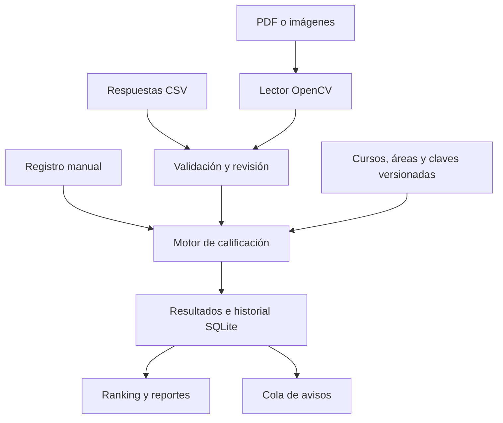

# Arquitectura v2

Se conserva Node/Express, SQLite y la interfaz modular existente. El cálculo académico se extrae de las rutas y no depende de cómo se capturaron las respuestas. La asistencia pasa a un registro canónico SQLite y Excel queda como exportación.

## Invariantes del examen

- `totalQuestions` es la cantidad impresa; `areas[].requiredQuestions` es la cantidad evaluable del perfil.
- Cada pregunta física pertenece exactamente a un curso. Los cursos cubren el cuadernillo completo.
- Las reglas de cada área solo seleccionan preguntas de ese curso. Las cuotas suman el total evaluable.
- Una selección fija evalúa sus números concretos. En selección por cupo se rechaza un exceso de respuestas, sin elegir las más favorables.
- Todas las preguntas tienen clave, anulación explícita o puntuación por alternativa antes de validar.
- Los puntajes se acumulan como milésimas enteras; la salida conserva hasta tres decimales.
- El perfil, versión, revisión de claves, versión del motor, origen y hash de definición quedan asociados al resultado.
- Las versiones de cuadernillo son permutaciones completas de números de pregunta. En v2.0 no se permuta el orden A–E dentro de una pregunta.
- Después de validar se fija la estructura. Revisar claves crea una revisión, conserva las notas anteriores y recalcula todo en una transacción.

## Identidad e historial

`usuarios.uid` es estable aunque cambie el código visible. La recepción identifica al usuario por código y guarda su UID y datos de contexto. Un padrón por examen conserva su pertenencia aunque posteriormente cambie de ciclo. Las notas históricas no se reinterpretan usando una estructura inventada.

Los resultados tienen restricción de unicidad por examen y estudiante. Si un SQLite anterior contenía registros duplicados, la migración guarda los anteriores en `grade_history` y conserva la versión de mayor ID como registro actual.

## Lotes OMR

Los archivos quedan en un directorio privado, con nombres generados por el servidor. El trabajador procesa una tarea a la vez, fuera del hilo de Express. Los estados se conservan en `import_batches`; un reinicio devuelve a la cola los trabajos interrumpidos.

El QR firmado referencia una cartilla registrada. Se verifica examen, formato, versión y número de página. Las páginas de un mismo estudiante se agrupan; se requieren todas antes de confirmar. `imported_sheets` impide importar dos veces una misma página. El lote se registra de forma atómica y nunca reemplaza notas previas sin confirmación y motivo.

Las rutas de archivos guardadas en la base son relativas al directorio de datos para facilitar restauración. Las imágenes normalizadas se sirven por una API autenticada; no se publican en la carpeta estática.

## Autenticación

Cuentas individuales con roles, contraseñas scrypt, limitación de intentos, sesiones en SQLite, rotación al iniciar sesión, invalidación por versión de cuenta y protección CSRF en escritura. Las cookies usan SameSite y, en producción, HTTPS. La recepción se vincula por código y no hereda acceso a las notas.

Los datos de operación, secretos y logs se excluyen de Git. Los HTML de administración y las APIs académicas requieren sesión. La interfaz sanea el HTML heredado mediante DOMPurify y los nuevos componentes escapan los valores dinámicos.

## Avisos

La asistencia y el evento de notificación se guardan sin esperar una llamada de red. Los reintentos son persistentes, con deduplicación por evento y contacto. Los cortes inciertos no generan un reenvío automático. El transporte de Meta se mantiene separado de los eventos académicos y los webhooks comprueban firma antes de procesarse.

Una revocación de autorización cancela los mensajes aún pendientes para ese contacto. La publicación de un resultado y su notificación son acciones distintas. Cada aviso identifica la calificación concreta. Una corrección cancela los pendientes obsoletos y devuelve el examen a Listo; las notas sin publicar no ocupan la cola de entrega ni bloquean avisos de asistencia.

## Operación

Una instancia Node y SQLite local, con proceso Python por lote. No se introduce Redis ni un servicio de base de datos externo para esta escala. Para múltiples sedes o procesos de escritura distribuidos, planificar una evolución a PostgreSQL y trabajadores con reclamación distribuida antes de habilitar ese despliegue.
