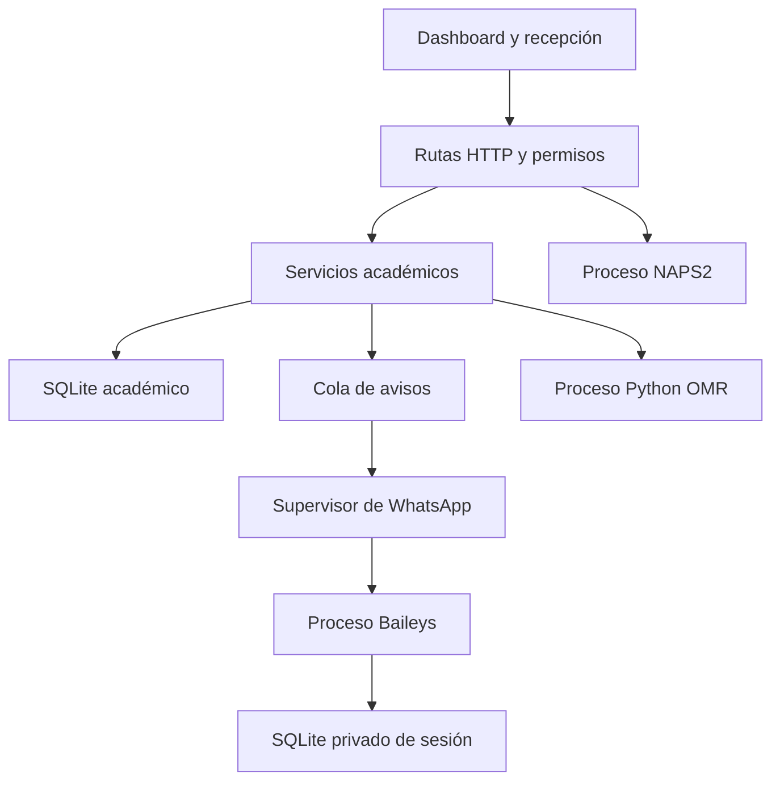

# Arquitectura y organización de INGEMAT

La aplicación conserva un monolito modular Express/SQLite y el frontend existente. La separación se concentra en las responsabilidades y los límites de fallo; mantiene los contratos académicos y evita añadir infraestructura de despliegue para una PC de academia.

## Recorrido de una operación

Los servicios de calificación, asistencia e importación usan la base académica. OMR, NAPS2 y Baileys son procesos externos con límites y manejo de errores. La dependencia de WhatsApp se carga únicamente dentro de su hijo, no en el proceso HTTP.

## Responsabilidades

| Ubicación | Responsabilidad |
|---|---|
| `app.js` | Middleware, sesión, CSRF, publicación de rutas y cierre ordenado |
| `src/routes/v2.route.js` | Contratos de la dashboard; delega Comunicación al router propio |
| `src/routes/notifications.route.js` | Controles administrativos de WhatsApp, QR privado y cola |
| `src/services/grading.service.js` | Reglas y cálculo determinista por área, curso y versión |
| `src/services/evaluations.service.js` | Exámenes, revisiones, notas e historial |
| `src/services/attendance.service.js` | Registro de asistencia; un fallo de avisos no invalida el ingreso |
| `src/services/imports.service.js` | Lotes, lectura, cotejo e importación atómica |
| `src/services/notifications.service.js` | Eventos idempotentes, cola, consentimiento, obsolescencia y estados |
| `src/services/notification-config.service.js` | Mensajes, variables y activación de Baileys |
| `src/services/baileys.service.js` | Supervisor IPC, plazos, latidos, fallos, QR y ciclo de vida |
| `src/whatsapp/baileys-worker.cjs` | Importación de la biblioteca y conexión real; sin abrir el SQLite académico |
| `src/whatsapp/auth-store.cjs` | Persistencia transaccional de credenciales/claves y mensajes del protocolo |
| `Public/js/admin/v2.js` | Coordinación del panel y módulos por funcionalidad |
| `Public/js/admin/notifications.js` | Interfaz de Comunicación, cargada de forma opcional y diferida |
| `Public/js/admin/scanner.js` y `key-editor.js` | Escáner y edición didáctica de claves |
| `src/services/workers.js` | Planificación acotada de colas; inicio idempotente y cierre del hijo |
| `scripts/check-whatsapp.cjs` | Diagnóstico del paquete en otro proceso, sin iniciar sesión |

## Aislamiento y eficiencia

- El paquete está fijado como dependencia opcional. Importarlo o ejecutar sus callbacks no ocurre dentro del servidor HTTP.
- El hijo tiene límite de heap JS de 256 MiB, tiempo de arranque, deadline por envío y supervisión por latidos. Las desconexiones transitorias tienen reconexión limitada; una caída de paquete abre el circuito y requiere revisión explícita.
- La sesión usa otro SQLite: una corrupción o bloqueo de credenciales se contiene en el componente de WhatsApp. Los avisos pendientes permanecen en la cola académica.
- Cada envío usa un ID estable. El padre lo registra antes de llamar al hijo, por lo que una confirmación temprana puede correlacionarse. Un proceso caído tras enviar deja un resultado incierto, sin reenvío automático.
- El hijo no importa servicios académicos ni hereda las variables de secretos de la app. Los eventos recibidos por IPC se reducen a estados e IDs controlados; no reescriben notas ni asistencias.
- El frontend carga Comunicación dinámicamente y captura el fallo de ese módulo. La consulta de salud es ligera, no trae la cola completa y no reinicia los textos que el operador edita.
- Los datos de lotes que no cambian no reconstruyen formularios. El historial es compacto y la limpieza de presentación es reversible por cuenta.
- Se retiraron los endpoints de API de pago y los diez módulos de interfaz de WhatsApp heredados sin referencias de entrada. No se mantiene un segundo panel de mensajería inactivo.

## Verificación y mantenimiento

Las pruebas cubren reglas académicas, HTTP y permisos, migración, OMR/PDF, escáner, cola, proceso hijo real que falla, plazos, persistencia de claves y UI con errores. El CI instala el lockfile, ejecuta diagnósticos, sintaxis, pruebas y auditoría. Los teléfonos y mensajes de pruebas son ficticios: vincular una cuenta real es un paso operativo posterior.

Para ampliar el panel, extrae una funcionalidad a un módulo con dependencias explícitas, como Escáner y Comunicación; conserva las rutas y pruebas de su recorrido. Los bloques académicos todavía agrupados en `v2.js` pueden separarse de la misma manera por asistente, resultados, reportes o biblioteca cuando se modifique cada uno. La organización actual no exige cambiar de framework para mantener la app.

## Contratos académicos conservados

### Invariantes del examen

- `totalQuestions` es la cantidad impresa; `areas[].requiredQuestions` es la cantidad evaluable del perfil.
- Cada pregunta física pertenece exactamente a un curso. Los cursos cubren el cuadernillo completo.
- Las reglas de cada área solo seleccionan preguntas de ese curso. Las cuotas suman el total evaluable.
- Una selección fija evalúa sus números concretos. En selección por cupo se rechaza un exceso de respuestas, sin elegir las más favorables.
- Todas las preguntas tienen clave, anulación explícita o puntuación por alternativa antes de validar.
- Los puntajes se acumulan como milésimas enteras; la salida conserva hasta tres decimales.
- El perfil, versión, revisión de claves, versión del motor, origen y hash de definición quedan asociados al resultado.
- Las versiones de cuadernillo son permutaciones completas de números de pregunta. En v2.0 no se permuta el orden A–E dentro de una pregunta.
- Después de validar se fija la estructura. Revisar claves crea una revisión, conserva las notas anteriores y recalcula todo en una transacción.

### Identidad e historial

`usuarios.uid` es estable aunque cambie el código visible. La recepción identifica al usuario por código y guarda su UID y datos de contexto. Un padrón por examen conserva su pertenencia aunque posteriormente cambie de ciclo. Las notas históricas no se reinterpretan usando una estructura inventada.

Los resultados tienen restricción de unicidad por examen y estudiante. Si un SQLite anterior contenía registros duplicados, la migración guarda los anteriores en `grade_history` y conserva la versión de mayor ID como registro actual.

### Lotes OMR

Los archivos quedan en un directorio privado, con nombres generados por el servidor. El trabajador procesa una tarea a la vez, fuera del hilo de Express. Los estados se conservan en `import_batches`; un reinicio devuelve a la cola los trabajos interrumpidos.

El QR firmado referencia una cartilla registrada. Se verifica examen, formato, versión y número de página. Las páginas de un mismo estudiante se agrupan; se requieren todas antes de confirmar. `imported_sheets` impide importar dos veces una misma página. El lote se registra de forma atómica y nunca reemplaza notas previas sin confirmación y motivo.

Las rutas de archivos guardadas en la base son relativas al directorio de datos para facilitar restauración. Las imágenes normalizadas se sirven por una API autenticada; no se publican en la carpeta estática.

### Autenticación

Cuentas individuales con roles, contraseñas scrypt, limitación de intentos, sesiones en SQLite, rotación al iniciar sesión, invalidación por versión de cuenta y protección CSRF en escritura. Las cookies usan SameSite y, en producción, HTTPS. La recepción usa cuentas individuales con permiso para registrar asistencias y sin acceso a las notas.

Los datos de operación, secretos y logs se excluyen de Git. Los HTML de administración y las APIs académicas requieren sesión. La interfaz sanea el HTML heredado mediante DOMPurify y los nuevos componentes escapan los valores dinámicos.

### Escala operativa

Una instancia Node y SQLite local, con procesos externos supervisados. No se introduce Redis ni otra base de datos para esta escala. Antes de distribuir escrituras entre sedes o servidores, planifica una base compartida y reclamación distribuida de trabajos.
